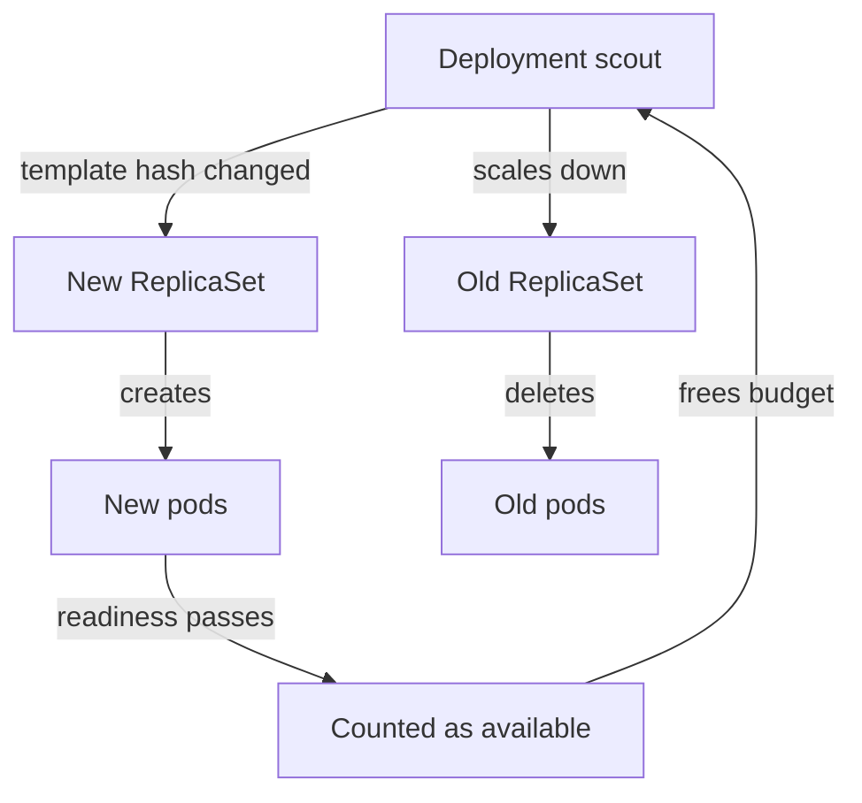

# Rolling Updates And Health Gates

A team wants to release a new setting for `scout`, the example service that runs four replicas in the `starfleet` namespace. The team cannot stop the service to do it. Requests keep arriving, so some replicas must keep answering while others change. This part shows how Kubernetes does that with a rolling update, which component does each step and which signal tells the controller that a new pod may take over.

A Deployment is a Kubernetes object that describes a set of identical pods and how to update them. It does not create pods itself. The Deployment controller, a program inside the `kube-controller-manager` process, watches Deployments and creates ReplicaSets. A ReplicaSet is an object that keeps a fixed number of pods with one exact pod template running. The Deployment owns ReplicaSets, and each ReplicaSet owns pods.

## What creates a new revision

The pod template is the `spec.template` part of the Deployment. It holds the container images, the environment variables, the probes, the resource requests, the labels on the pods and everything else a pod needs. The Deployment controller computes a hash of the template and stores it as the label `pod-template-hash` on the ReplicaSet and on every pod of that ReplicaSet. The hash is how the controller finds out which ReplicaSet matches the template that you declared.

When you change any field inside `spec.template`, the hash changes. No ReplicaSet has the new hash, so the controller creates one. That new ReplicaSet is the new revision. When you change a field outside the template, no new ReplicaSet appears. The most common example is `spec.replicas`: a change from four to six scales the current ReplicaSet and does not start a rollout. Changes to `spec.strategy`, `spec.minReadySeconds` and `spec.progressDeadlineSeconds` also do not create a revision. They change how the next rollout behaves.

Each revision gets a number, stored in the annotation `deployment.kubernetes.io/revision` on the Deployment and on its ReplicaSets. The old ReplicaSets stay in the cluster with zero replicas, up to `spec.revisionHistoryLimit` of them (ten by default). They are the data that a rollback uses.

<!-- astrona:playground:renew -->

Look at the starting state of the playground. The first command lists the ReplicaSets of `scout` with their pod counts. The second lists the pods with the hash label:

```sh
kubectl -n starfleet get replicasets -l app=scout
kubectl -n starfleet get pods -l app=scout --show-labels
```

You see one ReplicaSet with four desired, current and ready pods, and four pods that carry the same `pod-template-hash` value. The ReplicaSet name is the Deployment name followed by that hash.

## One rollout, step by step

The `scout` image, podinfo, shows a message on its web page when the environment variable `PODINFO_UI_MESSAGE` is set. Changing an environment variable changes the pod template, so it is a good way to start a rollout. Start one and watch it finish:

```sh
kubectl -n starfleet set env deployment/scout PODINFO_UI_MESSAGE="scout release 2"
kubectl -n starfleet rollout status deployment/scout
```

`kubectl set env` sends a patch to the API server and the API server stores the new template. `kubectl rollout status` then watches the Deployment object until its status shows that the update is complete, and it prints a progress line each time the status changes. The rollout is complete when every replica belongs to the new template, all of them are available and no old replica remains.

The controller works in a loop. In each pass it reads the Deployment, the old ReplicaSets and the new ReplicaSet, and it asks two questions. How many more new pods may it create without passing the surge limit? How many old pods may it remove without passing the unavailable limit? Then it scales the new ReplicaSet up and the old ReplicaSets down by those amounts. The ReplicaSet controller, another loop in the same process, creates or deletes the pods to match. The scheduler places the new pods and the kubelet on each node starts their containers.



The diagram shows that the Deployment controller never touches a pod directly. It changes the two ReplicaSets, and availability of the new pods decides when the next step may happen.

Now compare the two ReplicaSets after the rollout:

```sh
kubectl -n starfleet get replicasets -l app=scout
kubectl -n starfleet rollout history deployment/scout
```

The old ReplicaSet still exists with zero pods, and the new one has four. The history lists two revisions. The old object is kept on purpose, because it holds the exact old template for a rollback.

## Readiness is the gate

A new pod that has started is not yet a pod that can serve. A readiness probe is a check that the kubelet runs against a container, for example an HTTP request to a path. While the probe fails, the pod stays `NotReady`, and the Endpoints controller does not list the pod behind a Service. A Service sends no traffic to a pod that is not ready.

The same signal controls the rollout. The Deployment controller counts a pod as available only when the pod is ready (and has stayed ready for `minReadySeconds`, which the next part covers). Old pods are removed only as fast as the new pods become available. This is the mechanism that keeps a service up: a pod that never passes its probe never counts as capacity, so the controller never removes the old pod it was meant to replace.

The `scout` template in the playground declares this probe:

```sh
kubectl -n starfleet get deployment scout -o jsonpath='{.spec.template.spec.containers[0].readinessProbe}'
```

The output is the probe as JSON. It sends an HTTP GET request to the path `/readyz` on the container port named `http`. The podinfo image answers that path with a success status when the process is ready to serve.

## Liveness and startup are different questions

Three probe types exist, and they answer different questions. The readiness probe asks whether the pod may receive traffic now. The liveness probe asks whether the container is still working. When it fails often enough, the kubelet restarts the container. The startup probe asks whether the application has finished starting, and while it runs the kubelet holds back the other two probes.

Mixing them up causes real outages. A liveness probe that checks a slow database can restart healthy containers in a loop. A readiness probe that points at a path that does not exist keeps every new pod out of the Service forever. Only the readiness result feeds the rollout, so a rollout stalls on a bad readiness probe and does not stall on a bad liveness probe. A bad liveness probe shows up as a restart count that keeps growing.

## Overlap between old and new

During the rollout, both versions answer requests. The old and the new pods can be behind the same Service for several seconds or several minutes. Both must accept the same requests, read the same data and write data that the other can read. A release that changes a data format in a way that the old version cannot read is not safe for a rolling update, however well the probes work. The usual technique is to make the change in two steps: first release a version that reads both formats, then release the version that writes the new one.

You now know what a rollout is made of: two ReplicaSets, a hash that tells them apart and a readiness signal that gates each step. What you cannot yet do is predict how many pods move at a time or why a rollout sometimes waits. That is the next question.

## Common pitfalls

> [!WARNING]
> A change to `spec.replicas`, `spec.strategy` or `spec.minReadySeconds` does not create a revision and does not replace any pod. Do not wait for a rollout after such a change. A readiness probe that checks the wrong path or port keeps every new pod out of use, and the rollout then stalls without any pod crashing.
