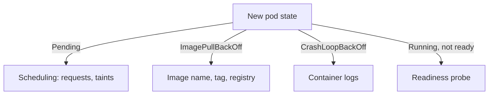

# Calculating Rollout Capacity And Diagnosing Progress

A rolling update is a trade between speed, capacity and risk. Replace many pods at once and the release finishes fast, but fewer pods answer requests. Replace one pod at a time and the service keeps its capacity, but the release is slow and needs room for an extra pod. The Deployment fields `maxSurge` and `maxUnavailable` set that trade in numbers. This part teaches you to calculate those numbers, to set the two timing fields that decide when a rollout counts progress, and to read a rollout that has stopped.

## The two budgets

`maxSurge` is the number of pods that may exist above the desired replica count during an update. `maxUnavailable` is the number of desired pods that may be missing from the available count during an update. Each field accepts a whole number or a percentage of the desired replicas. If you set neither, both default to 25 percent.

Kubernetes converts a percentage to a whole number before it uses it. It rounds `maxSurge` up and it rounds `maxUnavailable` down. The rounding is chosen so that a small deployment can still make progress: the surge is never zero because of rounding, and the unavailable count is never larger than you asked for. Both values cannot be the whole number zero, because the controller could not move, so the API server rejects such a spec. If percentages round both values to zero, the controller allows one unavailable pod so that the rollout can start.

| Desired replicas | Setting | Surge | Unavailable | Most pods that exist | Fewest available |
| --- | --- | --- | --- | --- | --- |
| 4 | 25% and 25% | 1 | 1 | 5 | 3 |
| 3 | 25% and 25% | 1 | 0 | 4 | 3 |
| 10 | 25% and 25% | 3 | 2 | 13 | 8 |
| 4 | surge 1 and unavailable 0 | 1 | 0 | 5 | 4 |
| 4 | surge 0 and unavailable 1 | 0 | 1 | 4 | 3 |

Check the first row: a quarter of four is exactly one, so no rounding happens. For three replicas, 25 percent is 0.75. The surge rounds up to one, the unavailable count rounds down to zero. For ten replicas, 25 percent is 2.5, so the surge is three and the unavailable count is two.

<!-- astrona:playground:renew -->

Read the live values of `scout` in the playground. It declares no strategy, so the defaults apply:

```sh
kubectl -n starfleet get deployment scout -o jsonpath='{.spec.strategy}'
```

The output shows `RollingUpdate` with `maxSurge` and `maxUnavailable` both set to `25%`. With four replicas, the controller may create one extra pod and may let one pod be unavailable.

## Choosing an explicit strategy

The defaults suit many services, but a service that cannot lose any capacity needs a stricter setting. With `maxUnavailable: 0` and `maxSurge: 1`, the controller first creates one new pod above the desired count. It removes an old pod only after the new pod is available. The service never drops below four available pods, and the cluster must have room for a fifth pod while the update runs.

The other direction is `maxSurge: 0` with `maxUnavailable: 1`. No extra pod is created, so no extra capacity is needed. The controller removes an old pod first and then creates its replacement. The service runs with three of four pods for part of the time. Use this form only when the cluster has no room for an extra pod and the service can tolerate lower capacity.

Strategy fields are not in the pod template, so changing them does not start a rollout. Save this as `scout-strategy.yaml`:

```yaml
spec:
  minReadySeconds: 10
  progressDeadlineSeconds: 120
  strategy:
    type: RollingUpdate
    rollingUpdate:
      maxSurge: 1
      maxUnavailable: 0
```

Apply it as a patch:

```sh
kubectl -n starfleet patch deployment scout --patch-file scout-strategy.yaml
```

Then check that the revision did not change:

```sh
kubectl -n starfleet rollout history deployment/scout
```

The history has the same revisions as before the patch. The new strategy applies from the next template change onward.

## Two timing fields

`minReadySeconds` is the number of seconds that a new pod must stay ready, with no container crashing, before the controller counts it as available. The default is zero, which means a pod counts the moment its readiness probe first passes. A pod can pass its probe once and then fail a few seconds later. With `minReadySeconds: 10`, the controller waits ten seconds of stable readiness before it removes the next old pod. The field delays the whole rollout by that time for each step, so keep it short.

`progressDeadlineSeconds` is the number of seconds the controller waits for progress before it reports that the rollout has failed. The default is 600. The controller restarts the timer each time it sees progress, for example when a new pod becomes available. When the timer runs out, it sets the condition `Progressing` to `False` with the reason `ProgressDeadlineExceeded`. The value must be larger than `minReadySeconds`.

The deadline only reports. It does not stop the controller, it does not undo anything and it does not delete the new pods. The controller keeps trying to finish the rollout. Whether a person or an automation system reacts to the condition is a separate decision.

## A rollout that stalls

Break a rollout on purpose to see the evidence. Save this as `scout-bad-probe.yaml`. It points the readiness probe at a path that podinfo does not serve:

```yaml
spec:
  template:
    spec:
      containers:
        - name: scout
          readinessProbe:
            httpGet:
              path: /missing
              port: http
```

Apply it and look at the rollout without waiting for it to finish:

```sh
kubectl -n starfleet patch deployment scout --patch-file scout-bad-probe.yaml
kubectl -n starfleet rollout status deployment/scout --timeout=30s
```

The status command waits for the rollout and gives up after thirty seconds. It prints that the rollout is waiting, with the number of updated replicas. The container name `scout` in the patch makes Kubernetes merge the probe into the existing container instead of adding a second one.

Now read the evidence from the bottom up. First the pods:

```sh
kubectl -n starfleet get pods -l app=scout
```

One new pod has the status `Running` but shows `0/1` in the `READY` column. The container is alive and the probe fails. Three old pods are still ready. This is the effect of `maxUnavailable: 0`: no old pod was removed, because no new pod became available.

Then the cause. The events of a pod list each failed probe:

```sh
kubectl -n starfleet describe pod -l app=scout | grep -i "readiness probe"
```

The lines say that the readiness probe failed with an HTTP status of 404 for the path `/missing`. A 404 response is an answer from the application, so the network and the container work, and the path is wrong. If the probe had reported a connection refused error, the port or the process would be the suspect.

Last, the Deployment conditions. After the deadline of 120 seconds, read them:

```sh
kubectl -n starfleet get deployment scout -o jsonpath='{range .status.conditions[*]}{.type}={.status} {.reason}{"\n"}{end}'
```

The `Available` condition is `True`, because three pods still serve. The `Progressing` condition becomes `False` with `ProgressDeadlineExceeded` after the deadline. The two conditions together say: the service is up, and the release is stuck.

## Reading the cause from the state

The stalled state has a small set of causes, and each one leaves a different trace. A new pod in `Pending` means the scheduler found no node that fits its resource requests. Increasing surge makes this worse, because it creates more pending pods. A pod in `ImagePullBackOff` means the node cannot pull the image, so the image name, the tag or the registry access is wrong. A pod in `CrashLoopBackOff` means the container starts and exits, and the logs show why. A pod that is `Running` but not ready means the readiness probe fails, as you saw above.



The diagram shows that the pod state points to the next place to look. Fix the cause that the state names, because a change to the strategy does not repair a pod that cannot start.

You can now calculate what a rollout may do and read why it stopped. The `scout` Deployment in the playground is stuck on a bad template, and the open question is how to get back to a working revision and how to prove that the result is right.

## Common pitfalls

> [!WARNING]
> `ProgressDeadlineExceeded` is a report and not a rollback. The controller keeps the failed rollout in place and the old pods keep serving. Setting `maxUnavailable: 0` with a cluster that has no room for the surge pod stalls every rollout in `Pending`. Percentages round differently for surge and unavailable, so a three-replica Deployment at 25 percent allows no unavailable pod at all.
