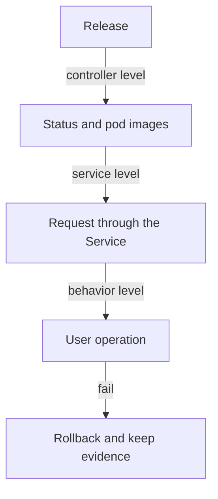

# Rollback, History And Verification

A release can go wrong in two ways. The cluster can refuse to finish it, as in a stalled rollout, or the cluster can finish it and the service can still behave badly. The first case shows in the Deployment status. The second case shows only when you test the service. This part covers the three tools for these cases: the revision history, the rollback command and a verification routine that checks what users see and not only what the controller reports.

## Where the history lives

Each time the pod template changes, the Deployment controller creates a ReplicaSet and gives it a revision number in the annotation `deployment.kubernetes.io/revision`. When a rollout replaces it, the old ReplicaSet scales to zero and stays. The Deployment keeps at most `spec.revisionHistoryLimit` old ReplicaSets, ten by default. When the limit is reached, the controller deletes the oldest one, and its revision can no longer be restored. If you set the limit to zero, no rollback is possible at all.

The history is therefore the list of ReplicaSets, each holding one complete pod template. It is not a log of who changed what. A third field helps with that: the annotation `kubernetes.io/change-cause`. The Deployment controller copies this annotation from the Deployment to the new ReplicaSet when it creates the revision, and `kubectl rollout history` shows it in the `CHANGE-CAUSE` column. You set the text yourself, so a short reason such as "scout message release 2" turns a list of numbers into a readable record.

<!-- astrona:playground:renew -->

Start with a working release and a recorded cause. Save this as `scout-release.yaml`:

```yaml
spec:
  template:
    spec:
      containers:
        - name: scout
          env:
            - name: PODINFO_UI_MESSAGE
              value: "scout release 3"
```

Apply it, wait for it and annotate the Deployment:

```sh
kubectl -n starfleet patch deployment scout --patch-file scout-release.yaml
kubectl -n starfleet rollout status deployment/scout
kubectl -n starfleet annotate deployment/scout kubernetes.io/change-cause="message release 3"
kubectl -n starfleet rollout history deployment/scout
```

The annotation is written to the Deployment after the rollout started. The controller copies it to the ReplicaSet the next time it syncs, so the newest history line shows the text. Annotate before you patch when you want the text on the revision that the patch creates.

## A release that fails to start

Now release an image that does not exist. Save this as `scout-bad-image.yaml`:

```yaml
spec:
  template:
    spec:
      containers:
        - name: scout
          image: ghcr.io/stefanprodan/podinfo:0.0.0-missing
```

Apply it and look at the pods:

```sh
kubectl -n starfleet patch deployment scout --patch-file scout-bad-image.yaml
kubectl -n starfleet get pods -l app=scout
```

Wait a few seconds and run the second command again. A new pod shows `ErrImagePull` and then `ImagePullBackOff`. The kubelet on the node tried to pull the image, the registry had no such tag and the kubelet backs off before the next try. The old pods are still ready, so the service still answers. The rollout does not progress, and after `progressDeadlineSeconds` the `Progressing` condition reports `ProgressDeadlineExceeded`.

## Rolling back

A rollback is a change of the pod template back to an earlier one. It is not a special undo of the cluster. `kubectl rollout undo` reads the chosen old ReplicaSet, copies its pod template into the Deployment and the controller starts a new rollout with the normal rules. The rolled-back template gets a new, higher revision number, because the controller handles it as an ordinary template change that happens to match an old ReplicaSet.

```sh
kubectl -n starfleet rollout undo deployment/scout
kubectl -n starfleet rollout status deployment/scout
kubectl -n starfleet get deployment scout -o jsonpath='{.spec.template.spec.containers[0].image}'
```

Without a flag, the command goes to the previous revision, which is the last one before the failed image. The image field now shows the podinfo version tag again. To go to a specific revision, add `--to-revision=<number>` with a number from `kubectl rollout history`. To see what a revision contains before you restore it, add `--revision=<number>` to the history command.

Look at what a rollback leaves alone. The strategy, the replica count, `minReadySeconds` and the deadline are not part of the template. They stay as they are. Objects outside the Deployment stay as they are too: a ConfigMap that was edited, a Secret that was rotated, a database table that was migrated and a Service that was changed. If the old image cannot work with the current schema, the rollback restores a template and not a working system.

## What a rollback cannot promise

A rollback needs the old ReplicaSet to exist, and it needs the old image to be available. A tag such as `latest` can point to different content today than yesterday. A rollback to a revision that names `latest` can therefore pull a different image than the revision ran before. The safest tag is an exact version or a digest, which is a hash of the image content.

A rollback also takes time and capacity, because it is a rollout. If the cluster had no room for the surge of the failed release, it has none for the rollback either, unless the failed pods have been removed first. Keep the evidence of the failure before you roll back. Save the pod description, the events and the logs of the failed pods, because the rollback deletes those pods.

## Verifying a release

The Deployment status says that pods are available. It does not say that the service is right. A useful verification has three levels, and each one catches a different failure.

- The controller level: `kubectl rollout status` succeeds, the updated and available replicas equal the desired replicas, and every pod uses the expected image and template hash.
- The service level: a request to the Service, sent from another pod, gets the expected answer from the new version.
- The behavior level: the one or two operations that matter to users, for example a request that creates a record, work on the new version.

Run the first two levels against `scout`. The `shuttle` pod in the playground has the `curl` tool, so it can act as a client inside the cluster:

```sh
kubectl -n starfleet get pods -l app=scout -o jsonpath='{range .items[*]}{.metadata.name} {.spec.containers[0].image} {.metadata.labels.pod-template-hash}{"\n"}{end}'
kubectl -n starfleet exec deploy/shuttle -- curl -s scout.starfleet.svc.cluster.local/
```

The first command lists each pod with its image and template hash. All lines must show the same image and hash after a finished rollout. The second command sends a request through the Service and prints the JSON answer from one of the pods. Look for the `message` field with the text that you released. Run the request several times and the Service balances across the pods, so every answer must show the same message once the rollout is complete.



The diagram shows that a release is accepted only after all three levels agree. A failure at any level leads to a rollback and a record of what was seen.

You now know how to read a revision history, how to restore a template and how to decide that a release is good. The practical skill is to combine these: correct a stalled release, keep the capacity during the fix and leave a record of the change.

## Common pitfalls

> [!WARNING]
> `kubectl rollout undo` restores only the pod template. It does not restore a changed ConfigMap, a rotated Secret, a database migration or the strategy fields. A rollback to a revision that uses a mutable tag such as `latest` can pull different content than the revision ran earlier. A finished rollout does not prove that the service works: send a real request.
