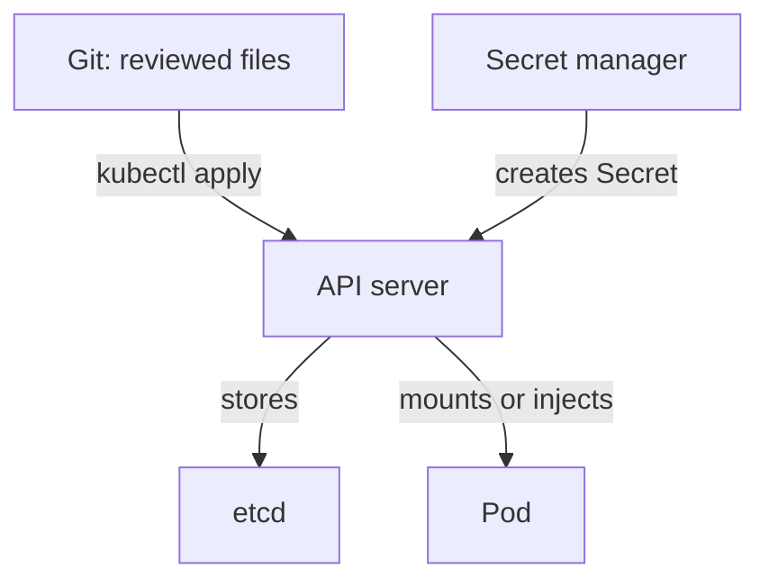

# Configuration As Declared Input

An application behaves according to two things: its code and its configuration. The code lives in an image that a build produces. The configuration is the set of values that tell the same image how to behave in one place: a message, a log level, an address, a feature switch. When a person logs in to a machine and edits a file, the configuration of that machine is known only to that machine. This part explains Configuration as Code (CaC), the practice that moves those values into files that people review and that tools apply, and it shows the Kubernetes objects that carry them.

## What Configuration as Code means

Configuration as Code means that the settings of an application or a system are written as text files, stored in a version control system such as Git and applied to the running system by a tool. The files are the source of truth. A reviewer can read a change before it happens, the history shows who changed what and when, and a second environment can be built from the same files.

Four properties make this useful. The files are **declarative**: they describe the wanted settings and not the commands that produce them. They are **versioned**: each change is a commit with an author and a reason. They are **reviewable**: a second person reads the difference before the change reaches a running system. They are **reproducible**: the same files and the same tool give the same settings every time.

CaC is not the same as Infrastructure as Code (IaC). IaC describes the infrastructure that the application runs on: networks, machines, clusters and their access rules. CaC describes the settings of the software that runs on top. The line is not sharp, and both practices use the same tools and habits. In this module, the infrastructure is a Kubernetes cluster that already exists, and the configuration is a ConfigMap, a Secret and the Deployment that uses them.

Storing a file in Git does not make a system configured by code. A script that copies the file once to a server leaves the server free to drift away from it. The practice also needs a step that applies the files again, and a way to see when the live system differs. Applying files again and comparing them with the live state is called reconciliation, and the last part of this module shows the manual form of it with `kubectl`.

## ConfigMap and Secret

A ConfigMap is a Kubernetes object that stores non-confidential settings as key and value pairs. A Secret is the same kind of object for confidential values such as tokens and passwords. Both are namespaced objects, and the API server stores them in etcd, the key-value database of the cluster.

A ConfigMap does nothing on its own. A pod must consume it, and a pod can do that in three ways: as an environment variable, as a file in a mounted volume, or as an argument that is built from an environment variable. The way a pod consumes the values decides when a change reaches the application, which is the topic of the next part.

<!-- astrona:playground:renew -->

Save this as `scout-config.yaml`. It holds two settings for `scout`:

```yaml
apiVersion: v1
kind: ConfigMap
metadata:
  name: scout-settings
  namespace: starfleet
data:
  message: "scout from a ConfigMap"
  log-level: "info"
```

Apply it:

```sh
kubectl apply -f scout-config.yaml
```

Then read the stored object back:

```sh
kubectl -n starfleet get configmap scout-settings -o yaml
```

The output shows the data you wrote and extra fields that the API server added: a UID, a creation time and a resource version. Look at the annotation `kubectl.kubernetes.io/last-applied-configuration`. The command `kubectl apply` stored your original file there. The command uses it later to calculate what you removed from the file, and the last part of this module explains how.

## What a Secret hides and does not hide

A Secret differs from a ConfigMap in how the platform treats it. Pods can mount it as a file in memory-backed storage, the API can limit who may read it through role-based access control (RBAC), and the cluster can encrypt it at rest in etcd when the administrator turns that on. It still has a weak point: the values in the `data` field are base64 text. Base64 is an encoding that anyone can reverse. It is not encryption.

Create a Secret from the command line and read it back:

```sh
kubectl -n starfleet create secret generic scout-token --from-literal=token=star-12345
kubectl -n starfleet get secret scout-token -o jsonpath='{.data.token}'
```

The second command prints a base64 string. Decode it:

```sh
kubectl -n starfleet get secret scout-token -o jsonpath='{.data.token}' | base64 -d
```

The command prints `star-12345`. Anyone who may read the Secret object can do the same. For that reason, a Secret file in Git is a leak, even when the value looks unreadable. Once a value is in the Git history, deleting the file later does not remove the value from the clones that exist.

## Keeping secrets out of the repository

Configuration as Code needs a plan for Secrets, because the files are the source of truth and the source of truth must not hold the secret. Teams use one of three approaches. They create the Secret outside Git, as you did with `kubectl create secret`, and the Deployment refers to it by name only. Or they commit an encrypted form that only the cluster can decrypt, for example with a controller that holds the key. Or they commit a small object that names a secret in an external secrets manager, and a controller in the cluster fetches the value and creates the Secret.

All three have the same shape: Git holds the name of the Secret and the key to read, never the value. A Deployment can refer to a key like this:

```yaml
env:
  - name: SCOUT_TOKEN
    valueFrom:
      secretKeyRef:
        name: scout-token
        key: token
```

The pod gets the token as an environment variable when the container starts. The file for the Deployment contains the name `scout-token` and the key `token`, and a reviewer can read it without seeing the token.

## Precedence and generated values

Settings often come from several places: a default in the image, a value in a ConfigMap, a command-line argument and an environment variable. The application decides which one wins, and the order is part of its documentation. In Kubernetes, one rule is fixed: if a container defines the same environment variable twice in `env`, the later entry wins, and entries in `env` win over values from `envFrom`. Know the order of your own application before you decide which file is authoritative.

A generated value is a second case. A tool can create a ConfigMap from literals or files at apply time, with a name that includes a hash of the content. The generated name is an output of the tool, so the files in Git show the input, and the cluster holds the result. The next parts use that on purpose.



The diagram shows that Git holds the reviewed settings, a separate path brings in the secret values, and the API server joins them for the pod.

You can now say what makes configuration code, which Kubernetes objects carry it and why a Secret needs a separate path. What remains open is a practical question: when you change a ConfigMap, does a running pod see the new value?

## Common pitfalls

> [!WARNING]
> Base64 is an encoding, not encryption. A Secret manifest in Git leaks the value even if you delete the file later. A ConfigMap in a Git repository does not make the cluster follow it: only an apply step, and a check for drift, does that.
