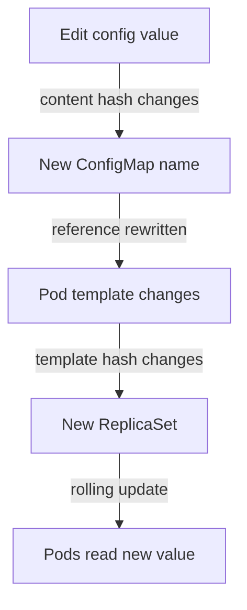

# How A Configuration Change Reaches Pods

A reviewed and merged change to a ConfigMap is only useful when the application starts to use it. Teams often assume that "applied" means "in effect". In Kubernetes the two are separate events, and the gap between them depends on how the pod reads the value. This part shows the three paths, measures the gap on a live pod and covers the techniques that close it: a restart, a checksum on the pod template, an immutable ConfigMap and a generated name.

## Two ways to consume a ConfigMap

A pod can read a ConfigMap as environment variables or as files in a volume. The kubelet, the agent on each node that starts the containers of a pod, prepares both before the container starts. For an environment variable, the kubelet asks the API server for the ConfigMap value and sets it in the container environment. A process environment is fixed when the process starts, and nothing can change it from outside afterwards. For a volume, the kubelet writes the keys as files into a directory and mounts the directory into the container. The kubelet keeps that directory in sync with the API on a timer, so the files can change while the container runs.

The result is a rule that every Kubernetes engineer should know. A changed ConfigMap value never reaches a running environment variable. It reaches a mounted file after a delay, and only when the application reads the file again. The application may read the file once at startup, and then it also needs a restart.

There are exceptions to the volume path. A file mounted with `subPath` is a single file that the kubelet copies once, and the kubelet never updates it. A ConfigMap with `immutable: true` cannot change at all. And a ConfigMap that is consumed through a Pod's `envFrom` has the same fixed-at-start behavior as one read through `configMapKeyRef`.

## Measure the gap

Run the experiment on a real pod. Save this as `reader.yaml`. It creates a ConfigMap and a Deployment `reader` that consumes the same key twice, once as an environment variable and once as a file:

```yaml
apiVersion: v1
kind: ConfigMap
metadata:
  name: reader-settings
  namespace: starfleet
data:
  message: "reader message one"
---
apiVersion: apps/v1
kind: Deployment
metadata:
  name: reader
  namespace: starfleet
spec:
  replicas: 1
  selector:
    matchLabels:
      app: reader
  template:
    metadata:
      labels:
        app: reader
    spec:
      containers:
        - name: reader
          image: ghcr.io/stefanprodan/podinfo:6.15.0
          env:
            - name: PODINFO_UI_MESSAGE
              valueFrom:
                configMapKeyRef:
                  name: reader-settings
                  key: message
          volumeMounts:
            - name: settings
              mountPath: /etc/reader
              readOnly: true
          ports:
            - name: http
              containerPort: 9898
          readinessProbe:
            httpGet:
              path: /readyz
              port: http
      volumes:
        - name: settings
          configMap:
            name: reader-settings
```

<!-- astrona:playground:renew -->

Apply it and wait for the pod:

```sh
kubectl apply -f reader.yaml
kubectl -n starfleet rollout status deployment/reader
```

Read the value through both paths:

```sh
kubectl -n starfleet exec deploy/reader -- printenv PODINFO_UI_MESSAGE
kubectl -n starfleet exec deploy/reader -- cat /etc/reader/message
```

Both print `reader message one`. Now change the ConfigMap. Save this as `reader-settings-two.yaml`:

```yaml
apiVersion: v1
kind: ConfigMap
metadata:
  name: reader-settings
  namespace: starfleet
data:
  message: "reader message two"
```

Apply it and read both paths again:

```sh
kubectl apply -f reader-settings-two.yaml
kubectl -n starfleet exec deploy/reader -- printenv PODINFO_UI_MESSAGE
kubectl -n starfleet exec deploy/reader -- cat /etc/reader/message
```

The environment variable still says `reader message one`. The file may still say `message one` too. Run the file command again every ten seconds for a minute or two. The kubelet checks for changes on a sync period, and it has a local cache of its own, so the delay is not fixed. Sooner or later the file shows `reader message two`, and the environment variable never does.

The Deployment object did not change, so the Deployment controller created no revision and replaced no pod. Run `kubectl -n starfleet rollout history deployment/reader` to confirm that only one revision exists. The ConfigMap changed in the cluster and the running application half-follows it. That state is the problem: two pods of one Deployment could even show different values for a short time.

## Closing the gap with a restart

The simplest way to make every pod read the new value is to replace the pods. `kubectl rollout restart` sets the annotation `kubectl.kubernetes.io/restartedAt` in the pod template with the current time. The template changes, so the Deployment controller starts a normal rolling update with all its safety rules:

```sh
kubectl -n starfleet rollout restart deployment/reader
kubectl -n starfleet rollout status deployment/reader
kubectl -n starfleet exec deploy/reader -- printenv PODINFO_UI_MESSAGE
```

The new pod prints `reader message two`. This works, but it is an imperative action. Nothing in Git says that this restart happened, so a person has to remember it after every ConfigMap change.

## Closing the gap in the files

The declarative way is to make the pod template depend on the content of the ConfigMap. If the template contains something that changes with the content, a content change is a template change, and a template change is a rollout. Teams do this in two ways.

The first is a checksum annotation. A tool computes a hash of the ConfigMap content and writes it into a pod template annotation such as `checksum/config`. Helm charts use this pattern with a template function. When the content changes, the hash changes, the template changes and the rollout starts.

The second is a generated name. Kustomize can generate the ConfigMap and add a hash of its content to the name, for example `reader-settings-7bdf4c2h9k`. It also rewrites every reference in the Deployment to the new name. A content change gives a new name. The Deployment template then refers to a different ConfigMap, which is a template change. The old ConfigMap stays in the cluster until something removes it, which is also what makes a rollback safe: the old template still points at the old ConfigMap, whose content did not change.



The diagram shows that a generated name turns a configuration change into an ordinary rollout, with the strategy, the probes and the history that the rollout already has.

## Immutable ConfigMaps

Setting `immutable: true` on a ConfigMap or a Secret tells the API server to reject any change to its data. The only way to change the value is to create a new object with a new name. That fits the generated-name approach. It also lowers the load on the API server, because the kubelet stops watching immutable objects. Try it. Save this as `reader-settings-frozen.yaml`:

```yaml
apiVersion: v1
kind: ConfigMap
metadata:
  name: reader-frozen
  namespace: starfleet
immutable: true
data:
  message: "frozen message"
```

Apply it, then try to change the value with a patch:

```sh
kubectl apply -f reader-settings-frozen.yaml
kubectl -n starfleet patch configmap reader-frozen --type=merge -p '{"data":{"message":"changed"}}'
```

The API server rejects the patch with an error that says the data of an immutable ConfigMap cannot be updated. You cannot turn the flag off again either. You delete the object and create a new one.

## What to check after a change

Match the check to the path. For an environment variable, check a pod that started after the change: `printenv` in that pod must show the new value, and the pod's start time must be later than the apply. For a file, check the file in every pod and remember the delay. For a rollout triggered by a generated name, check that the Deployment now refers to the new ConfigMap name and that every pod uses it.

You now know that "applied" and "in effect" are two events, and you know the techniques that tie them together. The remaining question is how to produce the files for several environments without copying them.

## Common pitfalls

> [!WARNING]
> An environment variable from a ConfigMap never changes in a running container, and a `subPath` mount never updates. Do not report a configuration change as live before you read the value in a pod that started after the change. Editing a ConfigMap does not create a Deployment revision, so a rollback cannot undo it.
