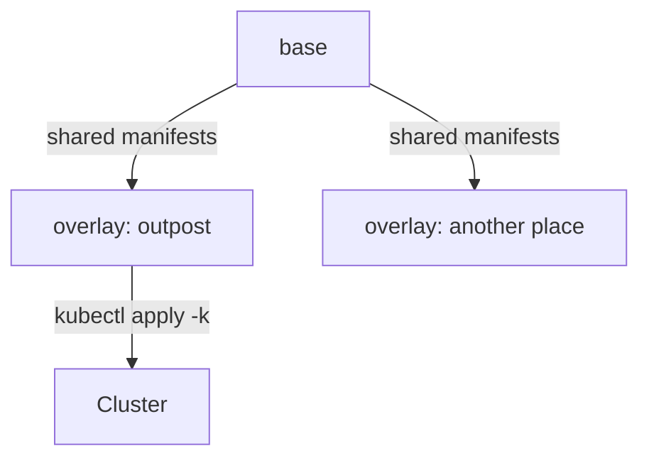

# Kustomize Overlays, Diff And Drift

One application usually runs in more than one place: a test namespace, a production namespace, a second cluster. The settings differ a little between them, such as the replica count or a message, and the rest is the same. Copying the whole file for each place makes the copies drift apart. Kustomize solves this by keeping one shared base and one small overlay per place. This part builds a base and an overlay for `scout`, applies the result with `kubectl apply -k`, and then uses `kubectl diff` to find a change that someone made by hand and to undo it.

## What Kustomize is

Kustomize is a tool that builds Kubernetes manifests from other manifests, without templates. It reads a file named `kustomization.yaml` that lists resources and transformations, and it prints the final YAML. It is built into `kubectl`, so no extra install is needed: `kubectl kustomize <directory>` prints the result, and `kubectl apply -k <directory>` builds and applies it in one step.

A **base** is a directory with a `kustomization.yaml` and the shared manifests. An **overlay** is another directory whose `kustomization.yaml` lists the base as a resource and adds changes on top: a namespace, a replica count, a label, a patch or a changed generator. The base never knows which overlays exist. Each overlay is a small set of reviewed differences, so a pull request that changes production shows only the production difference.



The diagram shows that every overlay reuses the one base, and that only the overlay you choose is applied.

## Build the base

Create the directories on your machine. The commands only create folders:

```sh
mkdir -p base overlays/outpost
```

<!-- astrona:playground:renew -->

Save this as `base/deployment.yaml`. The Deployment reads all keys of a ConfigMap named `scout-config` as environment variables with `envFrom`:

```yaml
apiVersion: apps/v1
kind: Deployment
metadata:
  name: scout
spec:
  replicas: 1
  selector:
    matchLabels:
      app: scout
  template:
    metadata:
      labels:
        app: scout
    spec:
      containers:
        - name: scout
          image: ghcr.io/stefanprodan/podinfo:6.15.0
          envFrom:
            - configMapRef:
                name: scout-config
          ports:
            - name: http
              containerPort: 9898
          readinessProbe:
            httpGet:
              path: /readyz
              port: http
```

Save this as `base/service.yaml`:

```yaml
apiVersion: v1
kind: Service
metadata:
  name: scout
spec:
  selector:
    app: scout
  ports:
    - name: http
      port: 80
      targetPort: http
```

Save this as `base/kustomization.yaml`. The `configMapGenerator` creates the ConfigMap from a literal value, and the base has no namespace:

```yaml
apiVersion: kustomize.config.k8s.io/v1beta1
kind: Kustomization
resources:
  - deployment.yaml
  - service.yaml
configMapGenerator:
  - name: scout-config
    literals:
      - PODINFO_UI_MESSAGE=scout base message
```

## Add the overlay

Save this as `overlays/outpost/kustomization.yaml`. It sets the namespace, a replica count and a label, and it merges a new message into the generated ConfigMap:

```yaml
apiVersion: kustomize.config.k8s.io/v1beta1
kind: Kustomization
namespace: outpost
resources:
  - ../../base
replicas:
  - name: scout
    count: 2
labels:
  - pairs:
      environment: outpost
    includeSelectors: false
configMapGenerator:
  - name: scout-config
    behavior: merge
    literals:
      - PODINFO_UI_MESSAGE=scout outpost message
```

Each field does one job. `namespace` sets the namespace on every resource. `replicas` changes the count of the Deployment named `scout`. `labels` adds a label to every resource, and `includeSelectors: false` keeps it out of the selectors. That matters because the selector of a Deployment cannot change after creation, and the older `commonLabels` field would add the label to the selector. `behavior: merge` combines the overlay's literals with those of the base generator, and the overlay value wins for the same key.

Render the result before you apply anything:

```sh
kubectl kustomize overlays/outpost
```

The output is plain YAML with three objects: the ConfigMap, the Service and the Deployment. Find the ConfigMap name. It has the form `scout-config-` followed by a short hash, and the `envFrom` entry in the Deployment shows the same generated name. Kustomize rewrote the reference.

## Apply and read the result

Apply the overlay:

```sh
kubectl apply -k overlays/outpost
kubectl -n outpost rollout status deployment/scout
```

The result has two pods, the label `environment=outpost` on every object and one generated ConfigMap. Read the ConfigMap names and the value in a pod:

```sh
kubectl -n outpost get configmaps
kubectl -n outpost exec deploy/scout -- printenv PODINFO_UI_MESSAGE
```

The pod prints `scout outpost message`. The overlay value won over the base value.

Now change the message in the overlay file, for example to `scout outpost message two`, and apply again. The content hash changes, so the ConfigMap gets a new name and the Deployment template refers to it. The Deployment controller starts a rolling update. Check it with `kubectl -n outpost rollout history deployment/scout`, which now lists two revisions, and with `kubectl -n outpost get configmaps`, which lists both generated ConfigMaps. The old one stays until you delete it or use pruning.

## Drift and how to find it

Drift is the difference between the declared state in the files and the live state in the cluster. It starts when someone changes the cluster directly. Suppose a person scales the Deployment during an incident and forgets to tell anyone:

```sh
kubectl -n outpost scale deployment scout --replicas=5
```

The files still say two. The cluster now runs five. Nothing in Git shows the change, and a later reader who trusts the files is wrong.

`kubectl diff` finds it. The command renders the same manifests as `apply` would send, asks the API server to evaluate them with a server-side dry run, and prints the difference from the live objects:

```sh
kubectl diff -k overlays/outpost
```

The output is a unified diff. The `replicas` line shows `5` as the live value being changed to `2`. Some metadata lines such as `generation` also appear, because the API server increments them. The exit code is useful in automation: `0` means no difference, `1` means differences were found, and a value above `1` means the command itself failed.

## Fixing drift

You have two choices, and which one is correct is a decision for people and not for the tool. If the change was a mistake, apply the files again and the cluster returns to the declared state. If the change was right, edit the overlay so that Git declares it, and apply. In both cases, the end state is that the files and the cluster agree.

Restore the declared state:

```sh
kubectl apply -k overlays/outpost
kubectl -n outpost get deployment scout
```

The Deployment returns to two replicas.

The reason this works is how `kubectl apply` merges. It stores the last applied manifest in the annotation `kubectl.kubernetes.io/last-applied-configuration`. At the next apply it compares three things: the last applied manifest, the new manifest and the live object. A field that is in the new manifest gets the new value, even when someone changed it by hand. A field that was in the last applied manifest and is gone from the new one is removed. A field that someone added by hand and that was never in a manifest is left alone, so a hand-made extra label survives an apply. A diff shows only what an apply would change, so it cannot show those extras either.

## What the tool does not do

Applying by hand is not continuous reconciliation. Nothing watches the cluster between your commands, so drift stays until a person or a scheduled job runs the diff. Continuous reconciliation is a controller that does the compare and apply loop on its own, and it is a separate subject. Kustomize also does not manage Secrets safely: the `secretGenerator` takes a literal value from the file, which puts the value into Git. Use it only with files that are not committed, or let the Deployment refer to a Secret that another process creates.

You now have the complete chain for configuration as code on a cluster: a reviewed base, a small overlay per place, a content-based ConfigMap name that starts a rollout, a diff that finds drift and an apply that removes it.

## Common pitfalls

> [!WARNING]
> Do not use `commonLabels` for labels that are not meant to be selectors: it changes the immutable selector of a Deployment. `kubectl diff` does not show fields that were added by hand and never declared, and an apply does not remove them. A generated ConfigMap leaves the old one behind, so delete it when no template refers to it. Never put a real secret value in a `secretGenerator` literal in a committed file.
