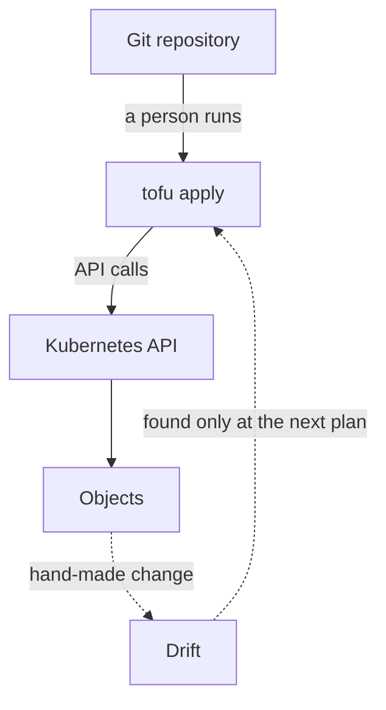

# Importing Resources And The GitOps Boundary

Most real environments do not start from empty files. Objects already exist, created by hand during an incident or by an older script. Writing a resource block for such an object and running `tofu apply` does not adopt it. This part shows what goes wrong, how an import block attaches the object without replacing it and why attaching an object is a smaller step than making the workflow GitOps.

## An object that exists before the files

Start with a ConfigMap that someone created by hand in the `dock` namespace. It holds a message of the day, and a script depends on it, so nobody can afford to delete it. Create it, and record the unique identifier (UID) that the API server gave it. A UID is a value that the API server generates when it creates an object, and a deleted and recreated object always gets a new one. The UID is how you prove later that the object was kept.

<!-- astrona:playground:renew -->

```sh
kubectl create namespace dock
kubectl -n dock create configmap dock-motd --from-literal=message="hello from the hand-made object"
kubectl -n dock get configmap dock-motd -o jsonpath='{.metadata.uid}{"\n"}'
```

Write the value of the UID down. In an empty working directory, save this as `versions.tf`:

```hcl
terraform {
  required_providers {
    kubernetes = {
      source  = "hashicorp/kubernetes"
      version = "~> 2.35"
    }
  }
}

provider "kubernetes" {}
```

Now describe the ConfigMap in a file named `motd.tf`. The text of the message differs from the hand-made value on purpose:

```hcl
resource "kubernetes_config_map_v1" "motd" {
  metadata {
    name      = "dock-motd"
    namespace = "dock"

  }

  data = {
    message = "hello from OpenTofu"
  }
}
```

Initialise, and try to apply:

```sh
export KUBE_CONFIG_PATH="$KUBECONFIG"
tofu init
tofu apply
```

The plan proposes to create the ConfigMap, because the state is empty and OpenTofu does not look for objects with the same name. The apply then fails with an error from the Kubernetes API that the object already exists. The provider asked the API server to create a second object with an existing name, and the API server refused. Nothing changed in the cluster.

## Import blocks

An import block tells OpenTofu that a real object belongs to a resource address. Add it to `motd.tf`:

```hcl
import {
  to = kubernetes_config_map_v1.motd
  id = "dock/dock-motd"
}
```

The `to` field is the address of the resource block, and `id` is the identity that the provider understands. For a namespaced Kubernetes object the identity is `namespace/name`. For a namespace it is just the name. The identity format belongs to each resource type, so a wrong format produces an error from the provider.

Run the plan:

```sh
tofu plan
```

The plan reports one resource to import. It also shows an update in place for `message`, because the files say `hello from OpenTofu` and the real object says `hello from the hand-made object`. This is the important point: an import attaches the object to the state, and it does not copy the real values into your files. If your block does not describe the object faithfully, the next apply changes the object to match the block. Read the diff before you apply. Apply it, and compare the UID:

```sh
tofu apply
kubectl -n dock get configmap dock-motd -o jsonpath='{.metadata.uid}{"\n"}'
```

The UID is the same as the one you wrote down, so OpenTofu changed the object and did not replace it. The message now reads `hello from OpenTofu`. After the apply, the import block has done its job. You can leave it in the file or remove it, and the next plan shows no changes either way.

An import has limits. OpenTofu does not check whether another controller or another state file already manages the object. If two tools manage the same object, each apply undoes the work of the other. Decide the single owner of an object before you import it.

## Is this workflow GitOps

The four GitOps principles describe a system in which the desired state is declarative, is stored as versioned and immutable history, is pulled automatically by an agent and is continuously reconciled. Compare them with what you have done so far.



The diagram shows that a person starts every apply, and that drift is found only when somebody runs a plan again.

The files are declarative. They are also versioned, when you keep them in Git. Those two principles are met. The other two are not. A person pushes the change with a command, and no agent pulls it. And nothing reconciles continuously: a manual change stays unnoticed until someone runs `tofu plan`.

A workflow can meet more principles in two ways. A pipeline can run `tofu apply` when a commit reaches the main branch and run a scheduled plan with `-detailed-exitcode` to detect drift. That automates the trigger and the detection. It is still a push model, because the pipeline holds credentials for the cluster and sends the change from outside. A controller that runs inside or beside the infrastructure, watches a repository and applies it again and again meets the pull and reconciliation principles. Some tools run OpenTofu or compatible providers as a controller for this purpose. The name of the tool does not decide the question. The control path does: who starts the apply, from where, how often, and what happens to drift.

Infrastructure as code is therefore a smaller idea than GitOps. It gives you declarations, a plan and state. GitOps adds an agent that pulls an identified version and keeps the real system equal to it. A team can use IaC without GitOps, and a team that wants GitOps for infrastructure must choose how the apply is pulled and repeated.

With this last piece, the idea is complete. Files declare, the plan shows, the state remembers, the plan detects drift, an import attaches older objects and the control path decides whether the result is GitOps. The module lab asks you to do the import and the repair on a cluster that starts with hand-made objects.

## Common pitfalls

> [!WARNING]
> - An import does not write the block for you. Describe the real object, read the plan and look for an update that you did not mean.
> - Check the UID, the creation time or the data to prove that the import kept the object. A destroy and create gives a new UID.
> - Do not import an object that another tool or controller still manages. The two tools overwrite each other.
> - A pipeline that runs `tofu apply` after each merge is automated and declarative. That alone does not make it pull-based or continuously reconciled.
