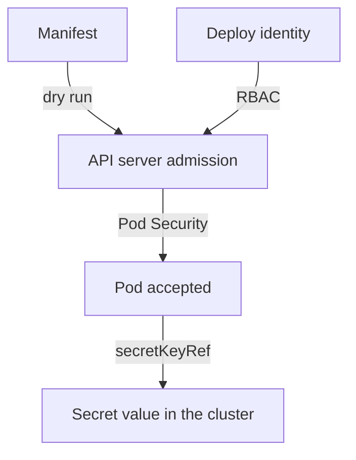

# Least-Privilege Deployment Identities And Secrets

A delivery path has two kinds of risk. One is the pod that it deploys, which the previous checks cover. The other is the identity that does the deploying. A pipeline or a person's tooling holds a credential for the cluster, and that credential is a target. If it can do everything, one leaked token gives an attacker everything. This part gives the deployment of `scout` its own identity with only the rights it needs, and shows how to keep secrets away from files and from pods that do not need them.

## What least privilege means here

Least privilege means that an identity receives only the permissions that its task needs, in the narrowest scope that works. A deployment identity for `scout` needs to read and update one Deployment in one namespace. It does not need to read Secrets, create RoleBindings, delete namespaces or touch any other namespace. The Role of Kubernetes RBAC can limit rules even to named objects with the field `resourceNames`.

The reason to be strict is the size of the damage. The build and deploy tools run code from many sources: dependencies, scripts and third-party actions. A narrow identity limits what a compromised step can do. A broad identity turns a small supply chain problem into a cluster-wide one.

## Create the deployment identity

You act as the platform team. Save this as `scout-deploy.yaml`:

<!-- astrona:playground:renew -->

```yaml
apiVersion: v1
kind: ServiceAccount
metadata:
  name: scout-deploy
  namespace: dockyard
automountServiceAccountToken: false
---
apiVersion: rbac.authorization.k8s.io/v1
kind: Role
metadata:
  name: scout-update
  namespace: dockyard
rules:
  - apiGroups: ["apps"]
    resources: ["deployments"]
    resourceNames: ["scout"]
    verbs: ["get", "patch", "update"]
  - apiGroups: ["apps"]
    resources: ["deployments"]
    verbs: ["list", "watch"]
---
apiVersion: rbac.authorization.k8s.io/v1
kind: RoleBinding
metadata:
  name: scout-deploy-update
  namespace: dockyard
subjects:
  - kind: ServiceAccount
    name: scout-deploy
    namespace: dockyard
roleRef:
  apiGroup: rbac.authorization.k8s.io
  kind: Role
  name: scout-update
```

The first rule limits `get`, `patch` and `update` to the Deployment named `scout`. The second rule allows `list` and `watch` on Deployments, because those verbs work on collections and cannot be limited by name in a useful way. The ServiceAccount sets `automountServiceAccountToken: false`, which stops Kubernetes from mounting a token into pods that use this account. The identity is for a deploying tool and not for a running pod, and a pod that does not call the API server should not hold a token. Apply it:

```sh
kubectl apply -f scout-deploy.yaml
```

## Prove what the identity can and cannot do

Ask the API server the questions a reviewer would ask. The first two should say `yes`. The rest should say `no`:

```sh
kubectl auth can-i patch deployment/scout -n dockyard --as=system:serviceaccount:dockyard:scout-deploy
kubectl auth can-i get deployments -n dockyard --as=system:serviceaccount:dockyard:scout-deploy
kubectl auth can-i delete deployments -n dockyard --as=system:serviceaccount:dockyard:scout-deploy
kubectl auth can-i get secrets -n dockyard --as=system:serviceaccount:dockyard:scout-deploy
kubectl auth can-i create rolebindings -n dockyard --as=system:serviceaccount:dockyard:scout-deploy
kubectl auth can-i list pods -n kube-system --as=system:serviceaccount:dockyard:scout-deploy
```

These six answers are the evidence that a security review needs, and a person can repeat them at any time. The second answer is `yes` through the list rule, while the `patch` on any other Deployment name would be `no`. Test that as well:

```sh
kubectl auth can-i patch deployment/other -n dockyard --as=system:serviceaccount:dockyard:scout-deploy
```

The answer is `no`, because the rule names only `scout`.

## Where secrets belong

The Deployment reads a token from the Secret `scout-token`. Look at how the Secret is stored:

```sh
kubectl -n dockyard get secret scout-token -o jsonpath='{.data.token}{"\n"}'
```

The value looks like random text, but it is base64, an encoding that anyone can reverse with `base64 --decode`. A Secret is not encrypted unless the cluster administrator enables encryption at rest in the API server, and even then any identity with `get` permission on the Secret receives the plain value. Two rules follow from this. Never write the value of a Secret in a file that you commit, so the repository holds only the name of the Secret and the key. And never give a deployment identity the permission to read Secrets unless its task needs it.

A pod receives a Secret in one of two ways. It can read one key as an environment variable with `secretKeyRef`, or it can mount the Secret as files in a volume. Only pods that need the value should have either. Add the reference to the container in `scout-restricted.yaml` under `env`, next to the other container fields:

```yaml
          env:
            - name: SCOUT_TOKEN
              valueFrom:
                secretKeyRef:
                  name: scout-token
                  key: token
```

The manifest holds the name `scout-token` and the key `token`, and the value stays in the cluster. A scanner that reads the repository finds no credential.

## Where each check sits in the path

A delivery path for `scout` now has several checks, and each one covers a different risk. The server-side dry run catches a manifest that the API server would refuse, including a Pod Security violation. The namespace label refuses an unsafe pod even if the dry run was skipped. The narrow deployment identity limits what the pipeline itself can change. An image scan, which this module does not run, would look for known vulnerable packages inside the image. None of them replaces another. A scan result of "no findings" says nothing about whether the deployment identity is too broad. Treat each check as evidence about one boundary, and ask which boundary is not covered yet.



The diagram shows that the identity passes the RBAC check, the manifest passes admission and the Secret value never appears in the manifest.

## Common pitfalls

> [!WARNING]
> - A base64 value is not protection. Anyone who can read the Secret can read the value.
> - Do not give a deployment identity `get` on Secrets because it is convenient. A leaked token then also leaks every Secret in the namespace.
> - `resourceNames` cannot limit `list`, `watch` or `create` by name. Know which verbs the rule really restricts.
> - A passing scan is not a passing review. Each check covers one boundary only.
