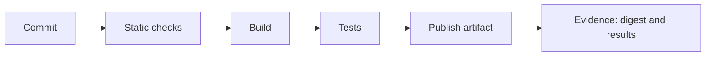

# Source Changes And Build Evidence

A change starts as a commit in a source repository. Continuous integration turns that commit into evidence: a record that says which checks ran, what they found and which artifact came out. The value of the pipeline is the evidence, because evidence lets a person decide whether a change is safe without repeating the work. This part writes a small check, runs it on a good and a bad manifest and reads what the result proves.

## The stages of a pipeline

A pipeline is a list of stages. Each stage takes the output of the previous one and either passes it on or stops the run. A typical order is: fetch the source, run static checks, build the artifact, run tests against the artifact, publish the artifact and record the result. Static checks read files without running the software. Tests run the software. A stage that fails stops the pipeline, and the person who made the change reads the failure message.

The word integration in CI means that changes from many people meet often. Small changes that meet often are easy to check and easy to undo. A long-lived branch that meets the main line once a month produces a large, risky merge. The check itself is only useful if it is fast and deterministic: the same input must give the same answer.

## Write the check

Your pipeline has one source file, a manifest of the `scout` Deployment, and one check script. The script does two things for each file. It asks the API server to validate the file without storing it, and it refuses any file that names an image with the tag `latest`. Save this as `ci-check.sh`:

<!-- astrona:playground:renew -->

```sh
#!/usr/bin/env sh
set -eu

for file in "$@"; do
  echo "checking $file"
  kubectl apply --dry-run=server -f "$file"
  if grep -n ':latest' "$file"; then
    echo "refused: $file uses the image tag latest" >&2
    exit 1
  fi
done
echo "checks passed"
```

The line `set -eu` makes the script stop at the first failed command and at the use of an unset variable. A server-side dry run sends the file through authentication, authorisation and admission, the same path as a real apply, and stores nothing. The `grep` command prints the offending lines and exits with a failure when it finds a match. Make the script executable:

```sh
chmod +x ci-check.sh
```

## Write the source change

The change under review is a new version of `scout`. Save this as `scout-release.yaml`:

```yaml
apiVersion: apps/v1
kind: Deployment
metadata:
  name: scout
  namespace: starfleet
  labels:
    app: scout
spec:
  replicas: 2
  selector:
    matchLabels:
      app: scout
  template:
    metadata:
      labels:
        app: scout
    spec:
      containers:
        - name: scout
          image: ghcr.io/stefanprodan/podinfo:6.15.0
          ports:
            - name: http
              containerPort: 9898
          readinessProbe:
            httpGet:
              path: /readyz
              port: http
          resources:
            requests:
              cpu: 10m
              memory: 32Mi
            limits:
              memory: 64Mi
```

## Run the check on a good and a bad change

Run the script on the file as it is. It should print the file name, the server answer that the Deployment would be configured and the line `checks passed`. Then make a bad copy that uses the tag `latest` and run the script on it:

```sh
./ci-check.sh scout-release.yaml
echo "exit code: $?"
sed 's/podinfo:6.15.0/podinfo:latest/' scout-release.yaml > scout-bad.yaml
./ci-check.sh scout-bad.yaml
echo "exit code: $?"
```

The first run exits with code 0. The second run exits with code 1, and the script prints the offending line. The exit code is the whole interface between a check and a pipeline. A pipeline tool reads it and stops or continues. Notice that the API server accepted the bad file. The server only checks that the object is valid, and `latest` is a valid tag. The rule that refuses it is your own policy, written as a check. A pipeline is where such team rules live.

## Read what a passing check proves

A pass means that the files were valid when the check ran and that no file broke the written rules. It does not mean that the software works, that the image is free of known vulnerabilities, or that the cluster will have room for the pods. Each of those needs its own check. When a report says "the pipeline is green", ask which risks the pipeline actually looks at.

## Collect the build evidence

A build produces an artifact, and for a container image the identity that matters is its digest. Find the image that the running pods use:

```sh
kubectl -n starfleet get pods -l app=scout -o jsonpath='{.items[0].spec.containers[0].image}{"\n"}'
kubectl -n starfleet get pods -l app=scout -o jsonpath='{.items[0].status.containerStatuses[0].imageID}{"\n"}'
```

The first value is the tag that the manifest asked for. The second value is the image identifier that the container runtime reports. It normally contains the image name followed by `@sha256:` and a long hash, which is the digest. The tag is a label that someone can later point at another image. The digest is computed from the content, so two images with the same digest are the same image. Evidence from a build therefore says which digest was built, which checks ran against it and which source commit it came from.



The diagram shows each stage passing its output to the next, and the evidence that the last stage records.

## Common pitfalls

> [!WARNING]
> - A passing dry run only proves that the object is valid. It does not prove that the image is safe or that the application works.
> - Do not trust a tag as an identity. The same tag can point at a different image tomorrow.
> - A check that is slow or unreliable gets skipped. Keep the checks fast and deterministic.
> - Do not write a check that prints the failure but exits with code 0. The pipeline reads only the exit code.
