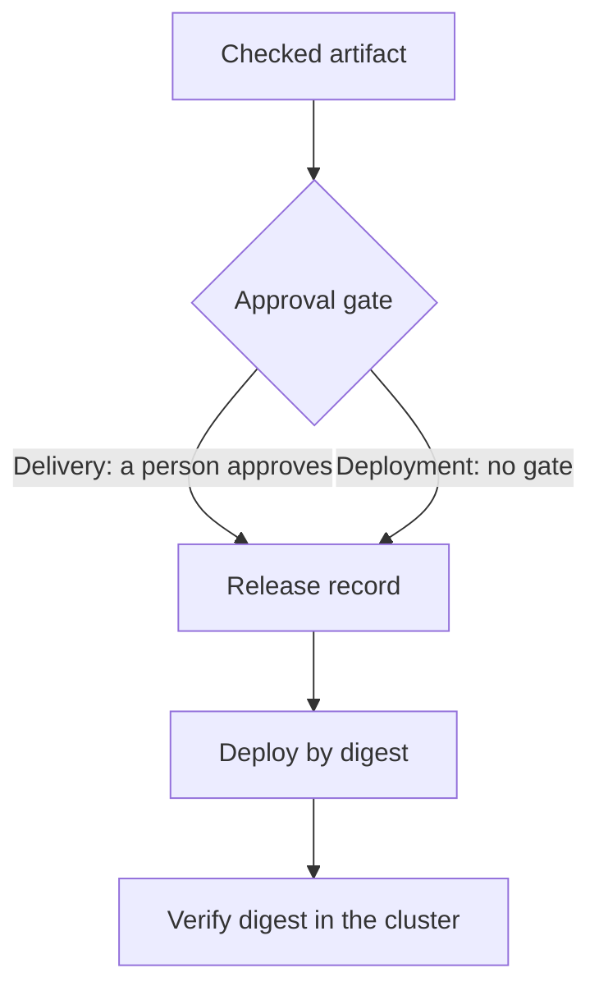

# Delivery, Deployment And Release Identity

A checked artifact is not yet running software. Something must decide that the artifact goes to an environment, and something must record what was decided. The two words delivery and deployment name two different answers to who decides. This part shows both, and then builds a release record that identifies a release by its digest so that anyone can tell exactly what runs.

## Delivery and deployment are different

Continuous delivery means that every change that passes the pipeline is ready to go to production at any time. The last step, the release itself, is started by a person or by an explicit approval. Continuous deployment means that every change that passes the pipeline goes to production automatically, with no approval. Both use the same stages. The difference is one gate at the end, and the gate is a business and risk decision, not a technical one. A team with weak tests or a service that cannot tolerate a bad release often chooses delivery. A team with strong tests and fast rollback can choose deployment.

A pipeline that has a manual approval step is continuous delivery, even when everything else is automatic. Calling it continuous deployment hides who is responsible for the release.

## The release is a record, not a tag

A release is more than an image. It is an image plus the configuration it runs with plus the source revision it came from. If a team writes only "release 1.4", nobody can say whether the image behind that name changed after the release. A release record fixes the facts. Kubernetes has no release object, but a ConfigMap is a simple place to write the record, and it lives next to the workload.

Read the facts that you need. The image identifier of the running pods gives the digest:

<!-- astrona:playground:renew -->

```sh
kubectl -n starfleet get pods -l app=scout -o jsonpath='{.items[0].status.containerStatuses[0].imageID}{"\n"}'
```

Copy the part after `@sha256:` for the next file. Save this as `release-record.yaml` and replace `DIGEST` with the hash you copied, without the prefix:

```yaml
apiVersion: v1
kind: ConfigMap
metadata:
  name: release-scout
  namespace: starfleet
  labels:
    app: scout
data:
  version: "6.15.0"
  image: ghcr.io/stefanprodan/podinfo
  digest: "sha256:DIGEST"
  source-revision: "rev-0042"
  approved-by: "platform-team"
```

The record holds the version a person would say aloud, the digest that identifies the image, the source revision and the name of the approver. The approver field is the gate of continuous delivery written down. Apply the record and the Deployment together:

```sh
kubectl apply -f release-record.yaml
kubectl -n starfleet annotate deployment scout kubernetes.io/change-cause="release 6.15.0 from rev-0042" --overwrite
kubectl -n starfleet rollout history deployment/scout
```

The annotation `kubernetes.io/change-cause` is copied to the revision, so the history lists the reason beside the revision number. The history now answers "what changed and why" for the cluster, and the ConfigMap answers "which exact image".

## Verify that the running image matches the record

A record is only evidence if someone can check it against reality. Read the digest from the record and from the pods and compare them:

```sh
kubectl -n starfleet get configmap release-scout -o jsonpath='{.data.digest}{"\n"}'
kubectl -n starfleet get pods -l app=scout -o jsonpath='{range .items[*]}{.status.containerStatuses[0].imageID}{"\n"}{end}'
```

Both pods should end with the same digest as the record. If one pod shows another digest, the Deployment is in the middle of a rollout or the tag was moved and some nodes pulled a different image. This is the failure that a tag hides and a digest exposes. A pipeline that deploys by digest cannot have this problem, because a node asked for a digest receives exactly that image or fails.

To deploy by digest, you set the image field to the form `name@sha256:hash` instead of `name:tag`. The node pulls that exact content. The cost is that the manifest is harder to read, so many teams keep the tag in a comment or in the record and let the pipeline write the digest.



The diagram shows that both models end in the same record and verification. They differ only in the gate.

## Who owns each decision

The stages of a pipeline map to decisions that different people own. The developer owns the source change and its tests. The platform team owns the pipeline and the rules in its checks. The release approver, in a delivery model, owns the decision to ship. Writing the approver in the release record makes that ownership visible later. When a release causes an incident, the record shows who approved which digest from which revision, so the review can focus on the decision and not on guessing what ran.

A pipeline also needs a rule for who may change the pipeline itself. If every developer can edit a check, a failing check can be removed instead of fixed. Treat the check script and the gate as reviewed files in the same repository.

## Common pitfalls

> [!WARNING]
> - A release identified only by a tag cannot be reproduced. Record the digest.
> - Do not call a path with a manual approval "continuous deployment".
> - A record that nobody compares with the cluster is a claim and not evidence. Verify it after each release.
> - Deploying by digest needs access to the registry. A node that cannot pull the digest fails to start the pod.
