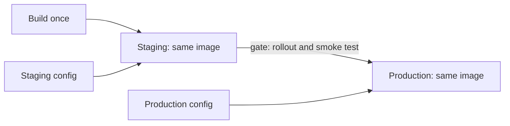

# Promoting One Artifact Through Environments

Promotion is the step that gives a pipeline its value. Staging exists to learn whether a release works. That knowledge only transfers to production if production runs the same artifact that staging ran. If production gets a fresh build of the same source, the two builds can differ, and the test evidence no longer applies. The rule is to build once and promote the same artifact, and to change only the configuration that is meant to differ.

## What differs between environments

Some things must differ: the number of replicas, the address of a database, a feature switch, the name of the environment. Other things must not differ: the image, the start command and the default behaviour of the code. The separation is the reason that configuration lives outside the image, in ConfigMaps and Secrets. The same image reads different configuration in each namespace.

Look at the two environments as they start:

<!-- astrona:playground:renew -->

```sh
kubectl -n staging get deployment scout -o jsonpath='{.spec.replicas}{" "}{.spec.template.spec.containers[0].image}{"\n"}'
kubectl -n production get deployment scout -o jsonpath='{.spec.replicas}{" "}{.spec.template.spec.containers[0].image}{"\n"}'
kubectl -n staging get configmap scout-settings -o jsonpath='{.data.environment}{"\n"}'
kubectl -n production get configmap scout-settings -o jsonpath='{.data.environment}{"\n"}'
```

The image is the same in both namespaces, and the replica counts and the `environment` values differ. That is the shape of a healthy setup.

## Release a new version to staging

A new version of `scout` is ready. Staging comes first. Save this as `scout-staging.yaml`:

```yaml
apiVersion: apps/v1
kind: Deployment
metadata:
  name: scout
  namespace: staging
  labels:
    app: scout
spec:
  replicas: 1
  selector:
    matchLabels:
      app: scout
  template:
    metadata:
      labels:
        app: scout
    spec:
      containers:
        - name: scout
          image: ghcr.io/stefanprodan/podinfo:6.15.1
          ports:
            - name: http
              containerPort: 9898
          envFrom:
            - configMapRef:
                name: scout-settings
          readinessProbe:
            httpGet:
              path: /readyz
              port: http
          resources:
            requests:
              cpu: 10m
              memory: 32Mi
            limits:
              memory: 64Mi
```

Apply it and wait for the rollout to finish:

```sh
kubectl apply -f scout-staging.yaml
kubectl -n staging rollout status deployment/scout --timeout=180s
```

The command `kubectl rollout status` waits until the new pods are ready and prints a message, and its exit code is 0 only when the rollout succeeded. That exit code is the first gate: a pipeline stops here if the new pods never become ready.

## Test the release in staging

A smoke test asks the running service for a result that proves its main function. The podinfo image answers on port 9898. Run a one-off client pod in the staging namespace that calls the service. First expose the Deployment inside the cluster:

```sh
kubectl -n staging expose deployment scout --port=80 --target-port=http
kubectl -n staging run smoke --rm -i --restart=Never --image=curlimages/curl:8.22.0 -- curl -fsS http://scout/healthz
```

The `-f` option makes `curl` exit with a failure for an HTTP error status, so the pod, and the command, fails when the service answers with an error. The `--rm` option removes the pod after it finishes. The result of this command is the second gate. It is not a full test, but it proves that the service starts and answers.

## Promote the same artifact

Production gets the same image. Only the replica count differs, and the ConfigMap in production keeps its own `environment` value. Save this as `scout-production.yaml`. Notice that the image line is identical to the staging file:

```yaml
apiVersion: apps/v1
kind: Deployment
metadata:
  name: scout
  namespace: production
  labels:
    app: scout
spec:
  replicas: 2
  selector:
    matchLabels:
      app: scout
  template:
    metadata:
      labels:
        app: scout
    spec:
      containers:
        - name: scout
          image: ghcr.io/stefanprodan/podinfo:6.15.1
          ports:
            - name: http
              containerPort: 9898
          envFrom:
            - configMapRef:
                name: scout-settings
          readinessProbe:
            httpGet:
              path: /readyz
              port: http
          resources:
            requests:
              cpu: 10m
              memory: 32Mi
            limits:
              memory: 64Mi
```

Apply it and verify that the environments run the same image identity:

```sh
kubectl apply -f scout-production.yaml
kubectl -n production rollout status deployment/scout --timeout=180s
kubectl -n staging get pods -l app=scout -o jsonpath='{.items[0].status.containerStatuses[0].imageID}{"\n"}'
kubectl -n production get pods -l app=scout -o jsonpath='{.items[0].status.containerStatuses[0].imageID}{"\n"}'
```

The two image identifiers should be the same, which is evidence that production runs what staging tested. A typo in the tag of the production file would show here as a different identifier. Doing a comparison like this at the end of every promotion is cheap and catches the most damaging mistake.



The diagram shows one artifact moving forward while each environment keeps its own configuration.

## Common pitfalls

> [!WARNING]
> - Do not rebuild for production. A new build is a new artifact, and staging did not test it.
> - Put the difference between environments in configuration, never inside the image.
> - A rollout that finished is not a service that works. Add a smoke test after the rollout.
> - Typing the image in two files invites a mismatch. Let the pipeline write the image into both from one value.
