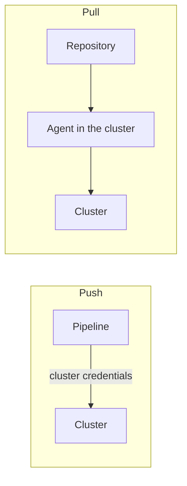

# Gates, Rollback And Pull-Based Delivery

Every promotion can fail. A good pipeline expects it. It adds gates that stop a bad release early, it keeps the previous release ready so that a rollback is one command, and it limits the credentials that a pipeline holds. This part breaks a release on purpose, rolls it back and then compares two ways of getting a change into the cluster.

## Break a release in production

A pipeline writes a release that cannot start. The image tag below does not exist, which stands in for any failure that the checks missed. Save this as `scout-bad.yaml`:

<!-- astrona:playground:renew -->

```yaml
apiVersion: apps/v1
kind: Deployment
metadata:
  name: scout
  namespace: production
spec:
  replicas: 2
  selector:
    matchLabels:
      app: scout
  template:
    metadata:
      labels:
        app: scout
    spec:
      containers:
        - name: scout
          image: ghcr.io/stefanprodan/podinfo:0.0.0-does-not-exist
          ports:
            - name: http
              containerPort: 9898
          readinessProbe:
            httpGet:
              path: /readyz
              port: http
```

Apply it and wait with a short timeout so that the gate fails quickly:

```sh
kubectl apply -f scout-bad.yaml
kubectl -n production rollout status deployment/scout --timeout=60s
echo "exit code: $?"
```

The status command waits, finds that the new pod is not ready and exits with a non-zero code after the timeout. With a rolling update, the old pods keep serving, because the Deployment does not remove an old pod until a new pod is ready. Production is degraded and not down. Look at the pods:

```sh
kubectl -n production get pods
kubectl -n production describe pods -l app=scout | tail -20
```

The new pod shows an image pull error in its state or events. A pipeline that sees the non-zero exit code of the rollout gate knows that the release failed and runs the rollback.

## Roll back

A rollback returns the Deployment to a previous revision. Kubernetes keeps the ReplicaSets of earlier revisions for this purpose. Look at the history, undo the last change and wait:

```sh
kubectl -n production rollout history deployment/scout
kubectl -n production rollout undo deployment/scout
kubectl -n production rollout status deployment/scout --timeout=120s
kubectl -n production get deployment scout -o jsonpath='{.spec.template.spec.containers[0].image}{"\n"}'
```

The image field shows the previous working image again. The undo command changes only the pod template. It does not undo changes to the ConfigMap, the replica count or other objects. If a release changed configuration together with the image, the rollback must restore both, which is a reason to keep the configuration in the same versioned source as the Deployment.

The rollback is a new revision with the old template, not a removal of the bad one. The history keeps the story of what happened. Record it, so that the next person reading the history knows why:

```sh
kubectl -n production annotate deployment scout kubernetes.io/change-cause="rollback after failed release" --overwrite
```

## Gates that belong in a promotion

Each gate stops a different kind of failure. A static check stops an invalid or forbidden manifest. The rollout status gate stops a release whose pods do not become ready. A smoke test stops a release that starts but does not work. An approval gate stops a release that nobody agreed to. A promotion is only as safe as the weakest of its gates, and each gate should state clearly what it proves.

## Push and pull delivery

In a push model the pipeline runs outside the cluster and applies the change with `kubectl` or a similar tool. For that, the pipeline needs credentials for the cluster, and those credentials can change production. A narrow identity limits the damage, but a stolen pipeline credential is still a way into the cluster.

In a pull model an agent runs inside the cluster, reads the desired state from a repository on a schedule and applies it. The pipeline only commits a change to the repository. The cluster credentials stay inside the cluster, and the agent also notices and corrects drift, because it keeps comparing. This is the idea of GitOps. The pull model changes where the credentials live and who applies the change. It does not remove the need for checks, gates and a rollback plan. A rollback in the pull model is a revert commit in the repository.



The diagram shows that the push pipeline reaches into the cluster while the pull agent reads from the repository.

## Common pitfalls

> [!WARNING]
> - `kubectl rollout undo` restores the pod template only. Check that the configuration matches too.
> - A rollback is not safe if the new release changed shared data, for example a database schema. Plan that part separately.
> - Give a pipeline the smallest credential that works, and not cluster administrator rights.
> - Pull delivery does not remove gates. It moves where the change is applied.
